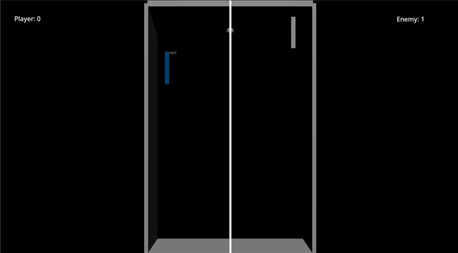

 # Ping Pong Game

A ping pong game made with **Godot** and **GDScript**. The project includes a user interface, game and input managers, and win/lose logic.

## Screenshots

Ping pong gameplay 

## Project Features

- **UI:** Presents the game interface and match information.
- **Game Manager:** Manages game state and the gameplay flow.
- **Input Manager:** Processes player input.
- **Win/lose logic:** Detects the match result and handles winning or losing.

## Built With

- Godot Engine
- GDScript

## Credits
- Created by VIKASH S, teengamedev @insta.

## Run the Game

1. Open the project in Godot.
2. Run the main scene from the editor.

